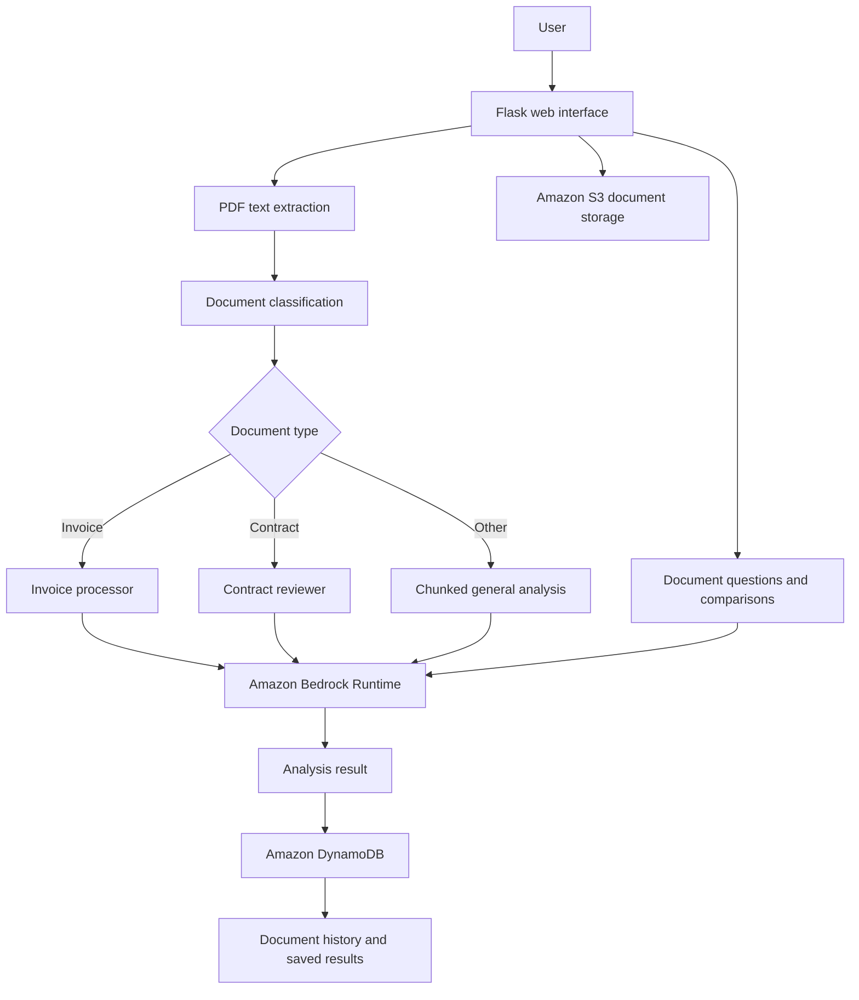

# AWS Bedrock Document Intelligence Platform

An AI-powered document analysis web application built with **Python, Flask, Amazon Bedrock, Amazon S3 and Amazon DynamoDB**. The project demonstrates how a document can be uploaded, stored, classified and analysed with a foundation model, with results available for later review.

## Project overview

The application provides a browser-based workflow for working with PDF documents. It extracts text from a PDF, classifies the document, and routes it to a specialised invoice or contract workflow, or to a general document-analysis workflow. Users can ask questions about a selected document and compare multiple documents.

This repository is a **portfolio and learning project**, not a hardened production service. Review the security and limitations notes before deploying it or using real or sensitive documents.

## Features

- **PDF upload** through the Flask web interface.
- **Amazon S3 storage** for uploaded documents.
- **Document classification** to choose a suitable analysis workflow.
- **Invoice processing** and **contract review** prompts.
- **General document analysis**, including chunked analysis for longer extracted text.
- **Ask questions about a selected document** using Amazon Bedrock.
- **Document history** backed by DynamoDB.
- **Document comparison**, including follow-up questions and saved comparison records.
- **Document deletion** from the application workflow.
- **Python logging** around Bedrock requests.

## Architecture

The main processing path in the current code is:



The diagram describes the application's logical flow. The current implementation is a Flask application that calls AWS services directly; it does not provision an independent processing pipeline or downstream consumer service.

## Technology stack

| Layer | Technology |
|---|---|
| Language | Python |
| Web application | Flask, HTML and CSS templates |
| PDF text extraction | pypdf |
| Foundation model access | Amazon Bedrock Runtime via Boto3 |
| Object storage | Amazon S3 |
| Document and comparison records | Amazon DynamoDB |
| Local configuration | python-dotenv |

The Bedrock client currently defaults to the Amazon Nova Lite model ID `amazon.nova-lite-v1:0`. The code allows this to be overridden with `BEDROCK_MODEL_ID`.

## Repository layout

The project uses a flat Python module layout:

| File or directory | Purpose |
|---|---|
| `main.py` | Flask application and web routes |
| `agent.py` | PDF analysis orchestration and document-type routing |
| `pdf_reader.py` | PDF text extraction |
| `document_classifier.py` | Document-type classification |
| `invoice_processor.py` | Invoice-focused analysis |
| `contract_reviewer.py` | Contract-focused analysis |
| `document_chunker.py` | Splits long text into smaller chunks |
| `bedrock_agent.py` | Calls Amazon Bedrock Runtime |
| `s3_manager.py` | Uploads and downloads documents from S3 |
| `s3_agent.py` | S3-backed document processing |
| `database.py` | Stores and retrieves document status and results in DynamoDB |
| `chatbot.py` | Questions about a document |
| `comparison_database.py` | Stores and retrieves document comparisons and follow-up questions |
| `delete_document.py` | Document deletion workflow |
| `chat_history.py` | Chat-history helper |
| `templates/` | Flask HTML templates |
| `requirements.txt` | Python dependencies currently listed by the project |

## Getting started

### Prerequisites

- Python installed locally.
- An AWS account and credentials configured for the AWS CLI or another supported Boto3 credential provider.
- Access to Amazon Bedrock in your chosen AWS Region, including access to the configured model.
- An S3 bucket and DynamoDB table matching the resource names configured in the code, or code changes to use your own resource names.

### 1. Clone the repository

```bash
git clone https://github.com/Jazblue/bedrock-document-intelligence.git
cd bedrock-document-intelligence
```

### 2. Create and activate a virtual environment

Windows PowerShell:

```powershell
python -m venv .venv
.\.venv\Scripts\Activate.ps1
```

macOS or Linux:

```bash
python3 -m venv .venv
source .venv/bin/activate
```

### 3. Install dependencies

```bash
python -m pip install -r requirements.txt
python -m pip install Flask
```

Flask is imported by the application but is not currently listed in `requirements.txt`, so it is installed separately in this example.

### 4. Configure AWS credentials

For local development, configure a named or default AWS CLI profile, for example:

```bash
aws configure
```

Use IAM credentials with only the permissions required by the application. Do not commit access keys or other secrets to the repository.

Create a local `.env` file in the project root if you need to override the defaults:

```dotenv
AWS_REGION=us-east-1
BEDROCK_MODEL_ID=amazon.nova-lite-v1:0
FLASK_SECRET_KEY=replace-with-a-long-random-local-secret
```

The code defaults the Bedrock region to `us-east-1` if `AWS_REGION` is not set. Choose a Region where the configured model is available and enabled for your account. Keep `.env` private and out of version control.

### 5. Check AWS resources

The current source code contains these resource names:

- S3 bucket: `bedrock-document-agent-storage`
- DynamoDB table: `document-analysis-results`

The application code does not currently read configurable `S3_BUCKET` or `DATABASE_TABLE` environment variables. If you use different resource names, update the relevant code before running the application. Ensure the DynamoDB table schema matches the application's use of `document_id` as its key.

### 6. Run the application

```bash
python main.py
```

Open the local address printed by Flask in your terminal (the current entry point uses Flask's default development server settings).

**Development only:** the current code starts Flask with debug mode enabled. Do not expose this development server directly to the public internet or use it as a production deployment.

## AWS permissions and cost

The precise permissions depend on the workflows you use. At a minimum, review the need for:

- **Amazon S3:** upload, download and delete access to the configured bucket and objects.
- **Amazon DynamoDB:** read/scan, put and update access to the configured table.
- **Amazon Bedrock:** permission to invoke the selected foundation model in the selected Region.

Prefer resource-scoped IAM policies and temporary credentials where possible. Avoid broad permissions such as unrestricted `s3:*`, `dynamodb:*` or `bedrock:*` unless there is a clearly justified reason.

Usage may incur charges for Bedrock model inference, S3 storage and requests, and DynamoDB reads and writes. Review AWS pricing and monitor usage before processing documents at scale.

## Security, privacy and current limitations

This repository is a learning project and should not be treated as production-ready without further engineering.

- **Authentication and multi-user authorisation:** the current application does not implement a complete sign-in system or robust per-user document access controls.
- **Upload validation:** add and test strict file-type, file-size, filename and content validation before accepting untrusted uploads.
- **Secrets:** set a strong `FLASK_SECRET_KEY` outside source control and keep AWS credentials out of the repository.
- **Debug mode:** disable Flask debug mode outside local development and deploy behind an appropriately configured production WSGI server and HTTPS endpoint.
- **S3 protection:** configure bucket Block Public Access, appropriate bucket policies and encryption in AWS. S3 versioning is not configured by the Python upload code itself; enable and verify it separately if required.
- **Data handling:** use synthetic or non-sensitive sample PDFs for demonstrations unless the deployment has been reviewed for the document types and privacy obligations involved.
- **Model output:** AI-generated analysis can be incomplete or incorrect. Verify important findings, especially in contracts, invoices and other high-impact documents.
- **Resource configuration:** the S3 bucket and DynamoDB table names are currently hard-coded in the source.
- **Testing and deployment:** add automated tests, operational monitoring, error handling and a production deployment configuration before relying on the service.

## Roadmap

Potential future improvements include:

- Authentication and user-specific authorisation, for example with Amazon Cognito.
- Configurable AWS resource names and environment-specific settings.
- Automated tests and continuous integration.
- Improved upload validation, structured errors and observability.
- Retrieval-augmented generation (RAG) and semantic search for larger document collections.
- A production deployment architecture with secure networking and a production WSGI server.

## Author

**Jason Harvey**  
GitHub: [@Jazblue](https://github.com/Jazblue)

---

This README documents the repository as it currently exists. AWS resources must be created and secured separately; cloning the project does not deploy or configure cloud infrastructure.
